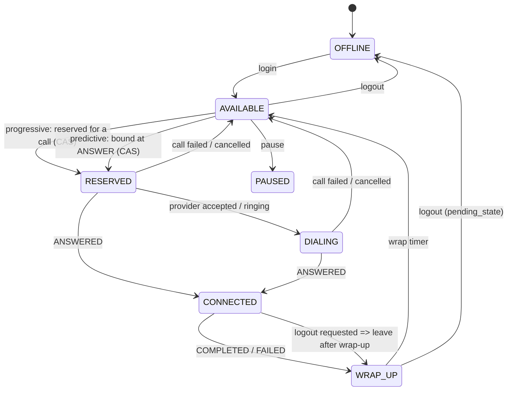

# Agent State Machine

## Agent Lifecycle



### Agent States (7 States)

1. **`OFFLINE`**: Agent logged out.
2. **`AVAILABLE`**: Agent logged in, ready to accept a call.
3. **`RESERVED`**: Agent locked for an outbound call (Progressive: reserved at dial time; Predictive: reserved at answer time).
4. **`DIALING`**: Call is dispatched and ringing.
5. **`CONNECTED`**: Agent talking to borrower.
6. **`WRAP_UP`**: Call ended; agent completing post-call wrap-up work for a configurable duration.
7. **`PAUSED`**: Agent temporarily paused / on break.

---

### Two Workers Seeing the Same Agent Concurrently

**The Problem:** Two dialer workers inspect the database and see the same `AVAILABLE` agent at the exact same millisecond.

**How SmartDialer Prevents Double-Reservation:**
1. **Atomic Conditional Compare-And-Swap (CAS):**
   ```sql
   UPDATE agents 
   SET state = 'RESERVED', call_id = ? 
   WHERE id = ? AND state = 'AVAILABLE';
   ```
   Both workers execute this inside their respective transactions. Exactly one worker gets `rowcount == 1`. The second worker gets `rowcount == 0` and is immediately notified that the agent was already claimed.
2. **Partial Unique Index Backstop:**
   A database-level unique partial index (`ux_call_agent_live`) enforces that an agent ID can appear at most once across all live calls:
   ```sql
   CREATE UNIQUE INDEX ux_call_agent_live ON calls(agent_id) 
   WHERE state IN ('RESERVED', 'INITIATED', 'RINGING', 'ANSWERED', 'CONNECTED');
   ```
3. **Fencing on Call ID:**
   When an agent is released, the release query requires `WHERE id = ? AND call_id = ?`, preventing delayed or out-of-order events from releasing an agent who has already moved to a newer call.
