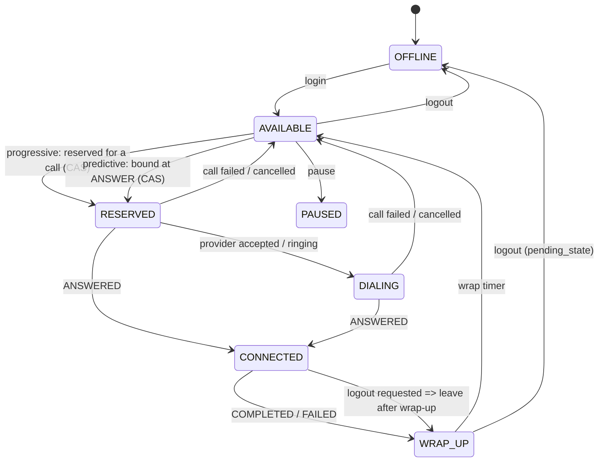
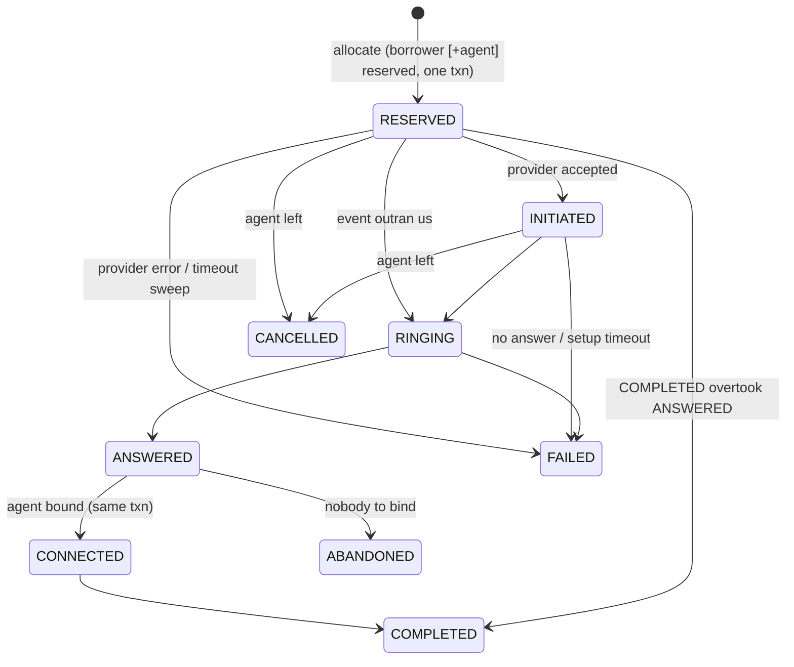

# Architecture note and decisions

## 1. Pipeline

```mermaid
flowchart LR
  C[Campaign: borrowers + mode] --> P[Pacing Engine<br/>Progressive | Predictive]
  P -- "PacingRequest(n, why)<br/>just data" --> S[Safety Controller<br/>APPROVE / REDUCE / REJECT / FALLBACK]
  S -- "ApprovedDispatch<br/>(unforgeable token)" --> A[Call Allocator<br/>atomic reserve]
  A --> PP[Provider Pool<br/>circuit breakers, idempotent dial]
  PP --> TA[Provider A: fast, reliable]
  PP --> TB[Provider B: slow, dup/out-of-order events]
  TA & TB -- events, at-least-once --> W[Dialer worker: apply_event]
  A & W <--> DB[(State store<br/>agents / calls / borrowers / events)]
  P -. reads snapshot .-> DB
  S -. reads abandon stats + provider health .-> DB
```

**The boundary.** The pacing engine returns a frozen `PacingRequest` and has no reference to the allocator or any provider.
`Allocator.execute()` only accepts an `ApprovedDispatch` carrying a private capability that only `SafetyController.review()`
can attach; a forged one raises `PermissionError` (tested). `Policy` is frozen and refuses `abandon_limit > 3%` or `max_ratio > 5`,
so there is no flag a pacing algorithm can flip to switch safety off. Progressive mode goes through the same controller.
(Python can't make this physically impossible; the point is that bypassing it needs a code change, not a config or a bug in pacing.)

## 2. State machines

**Agent**

**Call**

Rules: states have a rank; **events only move a call forward**; terminal states are absorbing. A stale/duplicate event is
recorded and ignored. `ANSWERED` arriving for a call we already wrote off (FAILED/CANCELLED) is an `ORPHAN_ANSWER`: a human
is on the line, so we hang up and count it against the abandon budget. (`QUEUED` is in the enum for completeness; calls are created already `RESERVED`.)

## 3. Concurrency and distribution — what I chose and why

**Decision: one transactional store is the single source of truth; workers are stateless and interchangeable.**
SQLite (`BEGIN IMMEDIATE`, WAL) stands in for PostgreSQL. No Redis, no Kafka, no cache in front of it.

| Problem | Mechanism |
|---|---|
| Two workers see the same AVAILABLE agent | Reservation is `UPDATE agents SET state='RESERVED' ... WHERE id=? AND state='AVAILABLE'` inside the same transaction that selects it; loser gets rowcount 0 / sees RESERVED. Backstop: partial unique index `ux_call_agent_live` (one live call per agent). Tested with 16 threads. On Postgres: `SELECT ... FOR UPDATE SKIP LOCKED` or the same conditional UPDATE. |
| Same borrower dialled twice | Borrower flips `READY -> IN_CALL` in the same txn that creates the call; backstop `ux_call_borrower_live`; `idem_key = borrower:dial_seq` is UNIQUE so a duplicate job can't create a second call. |
| Predictive over-dial across workers | The in-flight cap is **re-checked inside the allocation transaction** (check-and-reserve), not only at decision time. 8 workers asking for 100 each, 10 agents => exactly 40. |
| Duplicate / out-of-order provider events | `provider_events(provider, event_id)` PK dedupes; transitions are rank-monotonic so even a *new* id for a stale event is a no-op. |
| Crash after ANSWERED | The event insert and the state change are **one transaction**. Crash before commit => nothing happened and the provider redelivers (we ack only after commit). Crash after commit => redelivery is a `DUPLICATE`. |
| Crash between reserve and dial / between dial and saving the provider id | `sweep()` finds `RESERVED` calls older than `reserve_timeout` and re-drives them. Dial is idempotent on `client_ref = call_id`, and the pool first asks every provider `has_call(client_ref)`, so a call that did reach the provider is never placed twice. Events carry our `client_ref`, so they correlate even if we never stored the provider id. |
| Lost events | `sweep()` fails calls stuck in INITIATED/RINGING (`setup_timeout`) or CONNECTED (`max_call_seconds`), releasing agent + borrower. |
| Stale state / "DB says AVAILABLE, cache says RESERVED" | There is no cache of agent state. The DB row wins, always. Agent release is *fenced* by `call_id` (`WHERE id=? AND call_id=?`) so a late event can't free an agent already on another call. If a cache were added it would be advisory only. |
| Retries | Provider never accepted (nothing reached the borrower) => requeue after a short backoff, **no attempt consumed**. Reached the borrower and failed/no answer => attempt consumed, exponential backoff, give up after `max_attempts`. Abandoned => priority call-back. |
| Provider timeout is ambiguous | A timeout does not prove the call doesn't exist. We never fail over a timed-out call to the other provider (could double-dial); we best-effort cancel, fail the call, and if a ghost call is later answered we hang up and count it as an abandon. A definitive 5xx may be retried on the other provider. |

**Why not Redis/Kafka?** The hard invariants (agent held by at most one call, borrower in at most one live call, cap) are multi-row
constraints that need one atomic decision. A relational DB gives that directly; splitting state across Redis + DB would create the
exact "which one wins?" problem. Kafka only pays off once event volume exceeds what one DB can absorb (see section 6). It makes
exactly-once harder (you still need the idempotent consumer). What the simple design makes harder: a single hot DB is the ceiling, and
multi-region active-active is off the table.

## 4. Predictive logic: why N calls right now

```
A      = available agents + agents whose wrap-up ends within `horizon` (12s)       <- capacity by the time calls connect
p_up   = pessimistic answer rate: Beta posterior (recency-weighted last ~150 dial outcomes) mean + 1.5 sd
target = floor(A / p_up)       new = target - calls already in flight with no agent
```
Every decision stores its numbers: `predictive: A=12 (avail 10 + 2 freeing), p_hat=0.31 p_upper=0.38 (n_eff=61), target=floor(12/0.38)=31, in-flight=14 -> request 17`.
So "why 17 and not 10?" is a query on the `decisions` table. Pessimism is intentional: the harmful error is *under*-estimating the answer rate.
If the rate falls 70% -> 10%, the system merely under-dials briefly (cost: idle time). If it rises 10% -> 70% (the dangerous direction),
three layers act: (1) half-life 40 samples adapts fast; (2) the in-flight cap `ceil(4 x capacity)` bounds the worst case regardless of the estimate;
(3) the abandon budget trips to progressive after >0.8 x 3% of answered calls abandon in 5 min (and recovers only after cooldown + <=0.4 x 3%).
Also: predictive stays progressive until 30 outcomes are measured (cold start), and during provider degradation (>30% failures).

## 5. Safety Controller rules (evaluated in order)
1. Nothing requested -> IDLE. 2. All providers circuit-open -> **REJECT**. 3. Progressive, abandon-budget exhausted, provider degraded or not calibrated
-> **FALLBACK_PROGRESSIVE** (<= 1 call per *unclaimed* available agent). 4. Predictive: **REDUCE** to `ceil(max_ratio x (available+free_soon)) - in_flight`, capped per tick. 5. Otherwise **APPROVE**.

## 6. Simulation (results/simulation.md; 100 agents, 30 min, mixed providers, seed 7)
| Scenario | Progressive util | Predictive util | Predictive abandon rate |
|---|---|---|---|
| A 20% answer, 120s talk | 45% | 68% | 0.00% |
| B 50%, 90s | 62% | 73% | 0.00% |
| C 70%, 180s | 83% | 87% | 0.32% (Safety rejected or fell back on 322 of 1,800 ticks) |
| D changing (60%->15%->70%) | 58% | 71% | 0.41% |

Predictive helps most when answer rates are low (A) and least when they are high (C), where the headroom is small and Safety correctly restrains it.
Failure cases (section 2 of results): provider A hard outage (3 abandons, 0.21%), **both** providers down 60s (6 abandons, 0.42%; Safety REJECTs, no calls placed), only flaky provider B
(0 abandons; ~1,070 duplicate events ignored, 0 double transitions). Dropping 40 of 100 agents in 5s: 0 abandons, because every tick re-reads live agent state and the in-transaction cap uses it.
The unavoidable abandons in outages are calls already ringing whose ANSWER we can't see; they're bounded by the in-flight cap and counted.

Failure drills are also tests: worker crash (`TestCrashRecovery`), provider outage (`TestProviders`), duplicate/out-of-order events (`TestCallStateMachine`), agent drop (`TestAgentLeaves`).

## 7. What breaks first as agents grow
Measured here (`load_test.py`, in-process SQLite, so numbers are optimistic): 1,000 agents contended by 8 threads: ~16.7k reservations/s, 0 double reservations;
~7k events/s; per-tick read cost 0.1 ms (100) -> 0.6 ms (1k) -> 5.3 ms (10k) agents: **linear**.

1. **100 -> 1,000 agents: nothing; one Postgres is fine.**
2. **~1,000 -> 10,000: the per-tick global aggregates.** Every tick does `COUNT ... GROUP BY` over all agents and a scan of recent calls for stats, per worker. That is O(agents) work repeated by every worker, and it will also contend with the writers.
   Fix: keep counters incrementally (agent-state counts and in-flight counts updated in the same txn as the transition; rolling answer/abandon counters in a small table or in memory), and make **one pacing leader per shard** (lease with fencing token) instead of N workers all pacing the same pool.
3. **10,000+: the single hot allocation path + single writer.** All workers contend for the same `AVAILABLE` rows and the head of the borrower queue; serializable writes queue behind each other.
   Fix: shard by campaign / agent pool (an agent belongs to exactly one shard, so the invariants stay shard-local and need no cross-shard transaction), claim borrowers with `FOR UPDATE SKIP LOCKED` in batches.
   Only then does event ingestion matter: partition the event stream by `call_id` (so per-call ordering is preserved), then Kafka/queue earns its place.
4. At 100k agents: shard count and provider rate limits (CPS - calls per second - caps per provider/trunk) become the binding constraints, not the dialer.

## 8. Least confident about
- The answer-rate estimate is campaign-wide. If answer rates differ strongly by segment/time, a mixed pool can mislead it; per-segment estimates would be better.
- Outage handling: while a provider is silent we can't see answers. The cap bounds the damage but can't remove it.
- Each worker's snapshot -> decision is not atomic. Safety limits are re-checked in the transaction, so correctness holds, but pacing quality can overshoot with many workers (hence a leader per shard).
- Connected agents finishing soon are not counted in `A` (only wrap-up agents are). Using the talk-time distribution would raise utilization at no safety cost.

## 9. Final question: utilization of predictive, determinism of progressive
Make safety a **hard, state-based invariant** and let prediction be only an optimization inside it. Concretely: (1) pacing is a pure estimator that can only *request*;
(2) a separate controller turns the request into a number using limits that don't depend on the model being right: a cap on in-flight calls relative to agents who will exist by
connection time, a live abandon budget that falls back to progressive, a cold-start gate and provider-health gate; (3) reservation of agents/borrowers is atomic
in one store, so the invariants hold even with duplicates, crashes and N workers; (4) the estimate is deliberately pessimistic and every decision is explainable and logged.
The model buys utilization when it is right; when it's wrong the worst case is bounded by the cap, then by the budget, then the system degrades to one-call-per-free-agent. Further gain at zero compliance cost: grow the safe region with better data (talk-time hazard, per-segment rates) rather than a looser cap.
