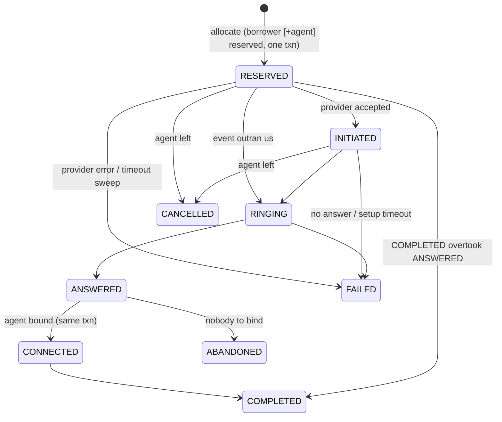

# Call State Machine

## Call Lifecycle

### Call States

- **`QUEUED`**: Initial borrower state in campaign.
- **`RESERVED`**: Call created; borrower (and in Progressive, agent) atomically reserved.
- **`INITIATED`**: Provider accepted the dial request.
- **`RINGING`**: Telecom provider confirms phone is ringing.
- **`ANSWERED`**: Borrower picked up.
- **`CONNECTED`**: Agent successfully bound to answered call.
- **`ABANDONED`**: Borrower answered but no free agent could be bound within compliance time.
- **`COMPLETED`**: Call successfully ended.
- **`FAILED`**: Network error, timeout, busy signal, or provider rejection.
- **`CANCELLED`**: Agent left mid-setup or system cancelled dial.

---

### Core State Invariants & Edge Cases

1. **Rank-Monotonic State Transitions:**
   Each state is assigned an integer rank (`RESERVED=1`, `INITIATED=2`, `RINGING=3`, `ANSWERED=4`, `CONNECTED=5`, `TERMINAL=6`). Transitions can only move strictly forward:
   - Duplicate events (e.g. `ANSWERED` $\times 3 \rightarrow$ `COMPLETED`) are recorded in the event log but discarded as no-ops.
   - Out-of-order events (e.g. `COMPLETED` arriving before `ANSWERED`) move the call directly to terminal `COMPLETED`. When `ANSWERED` or `RINGING` arrives later, it is identified as lower rank and ignored.
2. **Crash After ANSWERED:**
   The event log insert, agent binding, and call state transition are executed as a single atomic transaction. A worker crashing before commit results in a clean rollback; a crash after commit means the provider redelivery is safely deduplicated by `(provider, event_id)` primary key.
3. **Orphan Answers (Ghost Calls):**
   If an `ANSWERED` event arrives for a call previously written off (timed out or failed), SmartDialer classifies it as an `ORPHAN_ANSWER`, immediately triggers a provider hangup, and logs it against the abandon compliance budget.
